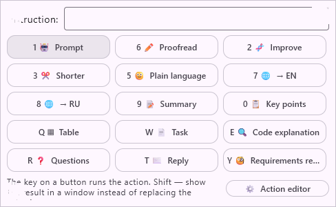
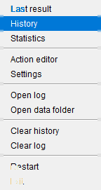
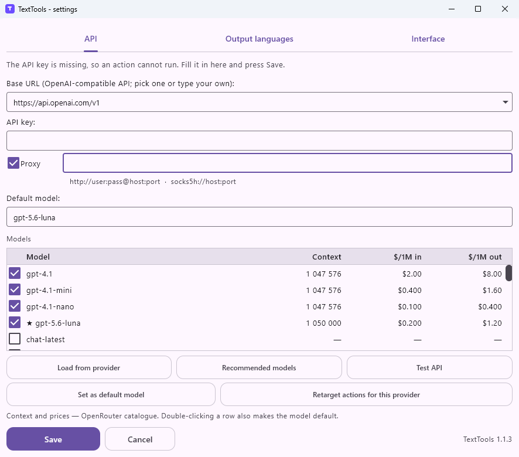
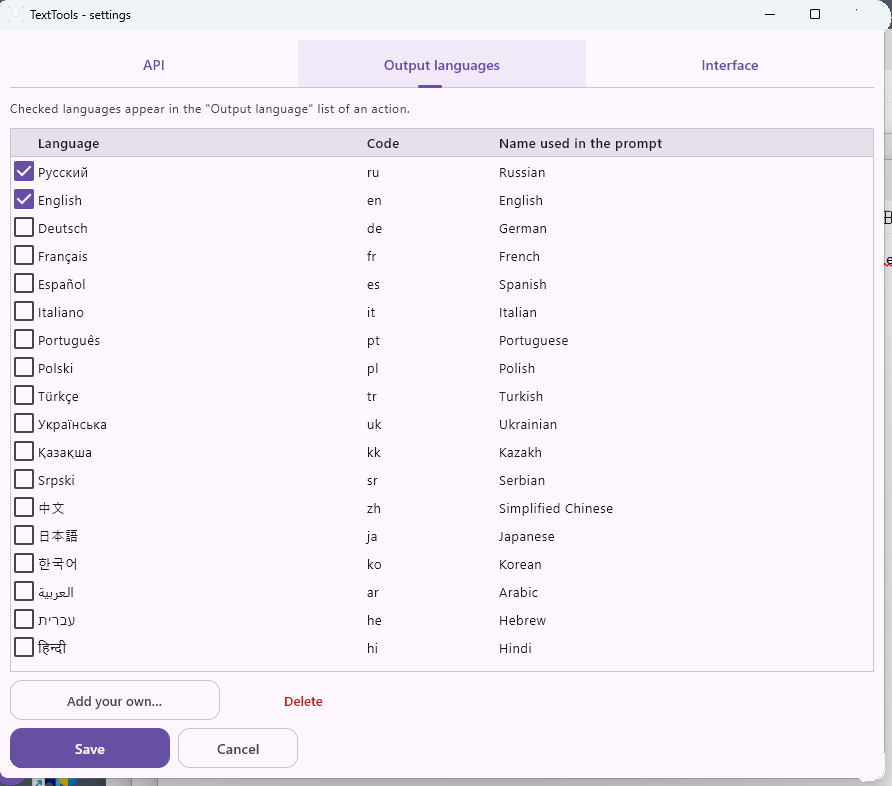
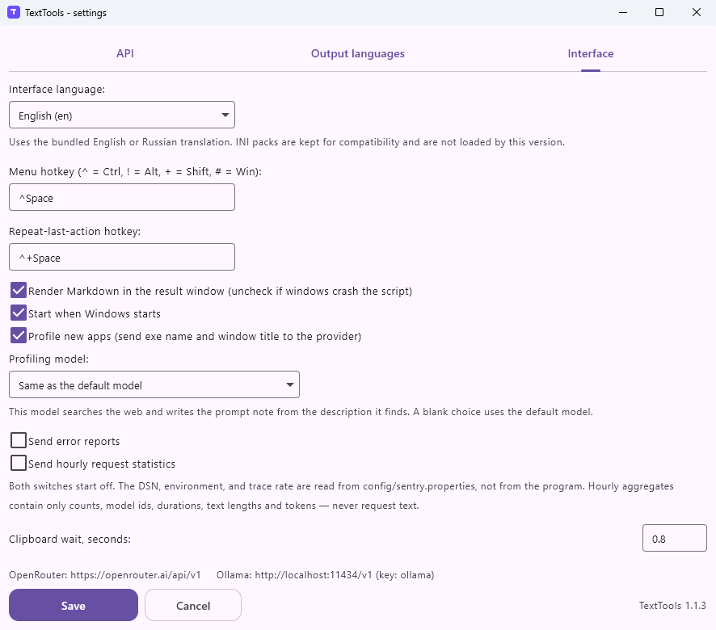
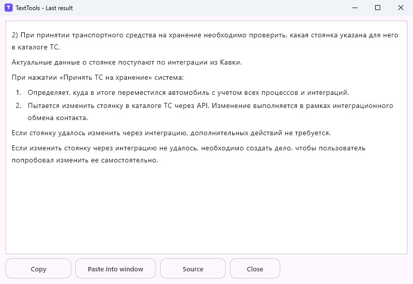

# TextTools

Tray application for the selected text. A hotkey runs an LLM action and pastes the result back, or shows it in a window. Capture and paste into other windows are implemented for Windows. The Linux and macOS builds open the tray.

Kotlin and Compose Desktop, version 1.1.2. The last AutoHotkey release is tag `v0.3.1` on branch `archive/ahk`. What changed is in `CHANGELOG.md`.

Ctrl+Alt+Space opens the action grid when text is selected. The grid opens on the window that held the selection. Shift on an action shows the result in a window instead of replacing the selection. Ctrl+Shift+Space repeats the last action. Fifteen factory actions ship with the app, and the instruction field runs a free-form one. While a request runs, the progress window shows an estimated token count and cost, then the figures reported by the provider. Quick refinements are buttons in that result window.



The tray menu opens the last result, history, statistics, the action editor and settings.



Settings has three tabs. The API tab is the OpenAI-compatible address, the key, an optional proxy, the default model, and the model list with context and price per million tokens. The key and the proxy stay in the operating-system secret store.



Checked output languages appear on an action. A language can be added by hand.



The interface language is the bundled English or Russian translation. INI language packs are not loaded. This tab also has the hotkeys, Markdown in the result window, start with Windows, app profiling, and the two error-report switches, which start off.



The result window copies the text or pastes it back into the source window.



## Windows installer

The installer follows the Windows language for English, German, Japanese, Simplified Chinese and Russian. It shows the MIT license from this repository and links to https://github.com/BelyaevAD/TextTools. You can choose a desktop shortcut, a Start menu shortcut, start with Windows, and launch TextTools when setup finishes. Capture into other windows works on Windows. The key stays in the system secret store.

## Requirements

JDK 21.

## Check and run

On Windows, use `gradlew.bat` instead of `./gradlew`.

```text
./gradlew check
./gradlew :app:run
```

## Installers

Each installer is built on its own OS and is not stored in git.

```text
./gradlew :app:packageMsi
./gradlew :app:packageDmg
./gradlew :app:packageDeb
```

The check workflow can build the same packages when started by hand. On a Mac, `sh packaging/macos/package-dmg.sh` from the repository root builds the DMG.

## Configuration

The API key and the proxy URL stay in the operating-system secret store. They are not written to the repository or to SQLite.

Error reports are off until both a DSN and a settings switch are present. Copy `config/sentry.properties.example` to `config/sentry.properties` (or to `%LOCALAPPDATA%\TextTools\sentry.properties`) and fill the DSN there. Do not commit that copy. Both Sentry switches start off.

## Docs and license

Module notes start at `docs/README.md`. The license is MIT.
